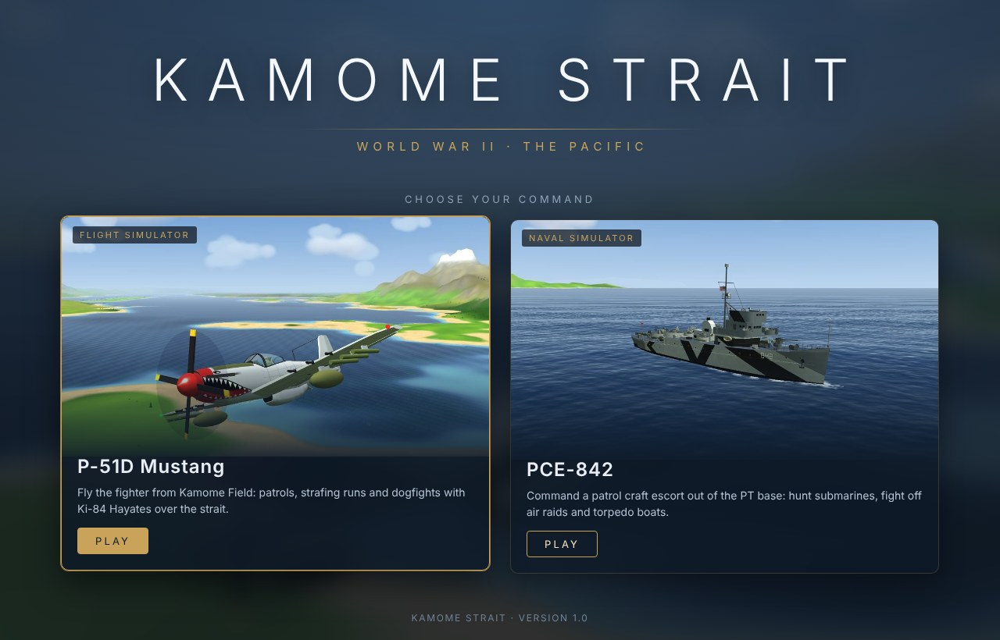

# Kamome Strait

The P-51 Mustang flight sim and the PCE-842 Patrol Craft Escort in one WWII South Pacific world. Fly the Mustang or command the ship; later, more simulators and multiplayer in the same world.

### [Play it in your browser](https://github.mrrat.org/Kamome-Strait/)



**Status:** version 1.0. The two games it grows from, still playable on their own from its start screen:

- [P-51 Mustang FS](https://github.com/MisterRat/P51-Mustang-FS)
- [PCE-842 Patrol Craft Escort](https://github.com/MisterRat/PCE-842_Patrol_Craft)

## Building

Every game is built from shared source pieces with plain Node (no dependencies):

```
node build.js            # writes build/P-51_Mustang_FS.html and build/PCE-842.html
node build.js --check    # also compares them byte for byte with baseline/ (kept on the disk, not in git)
```

`src/shared/` holds code every game uses, `src/<game>/` what only that game has, and `src/<game>.manifest` the order the pieces are joined in. The aircrew briefing map is [P-51_Mustang_FS_Briefing_Map.pdf](P-51_Mustang_FS_Briefing_Map.pdf). GitHub Pages publishes `build/Kamome_Strait.html` with the files in `site/` (`.github/workflows/pages.yml`).

## License

[PolyForm Noncommercial 1.0.0](LICENSE)
